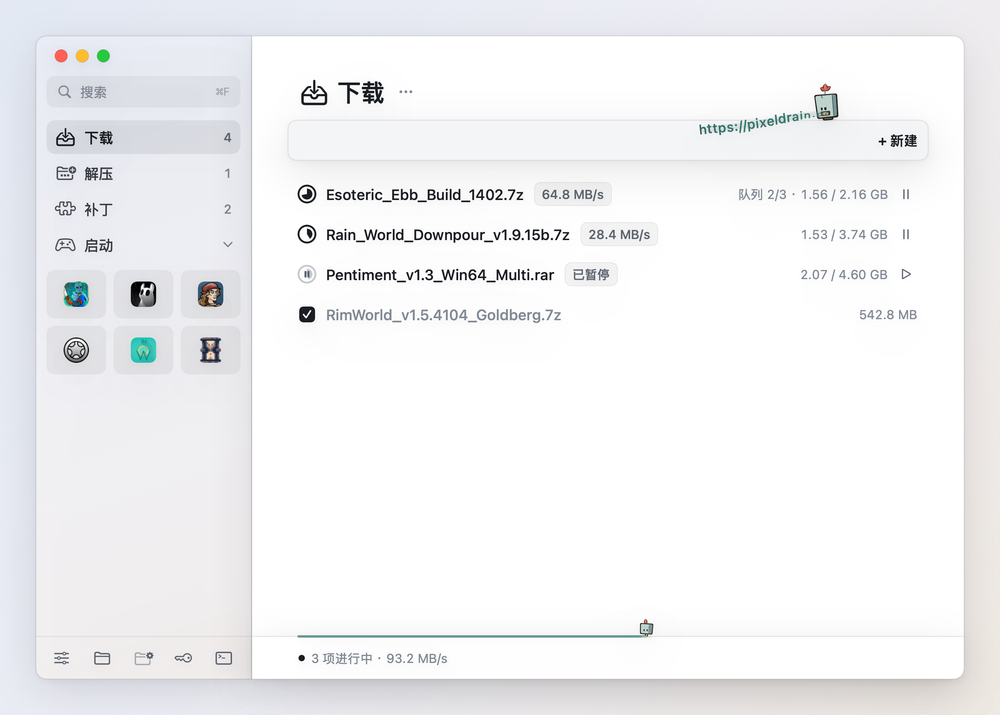
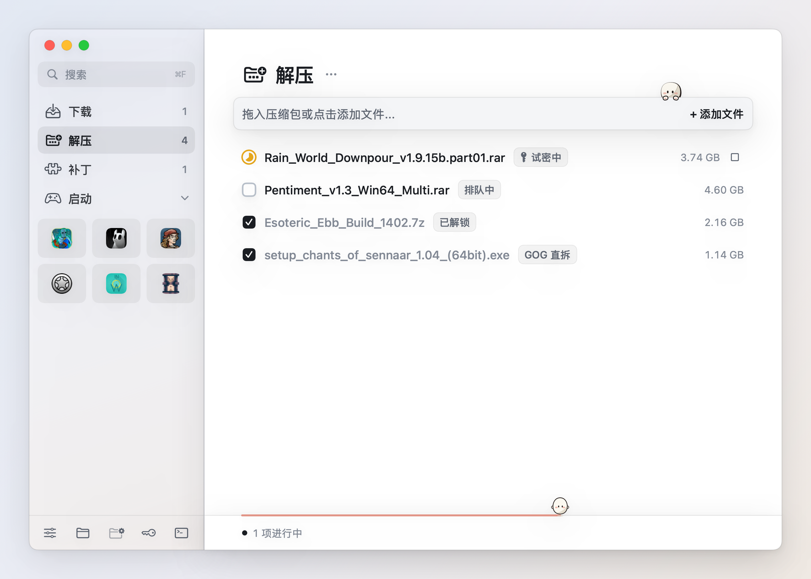
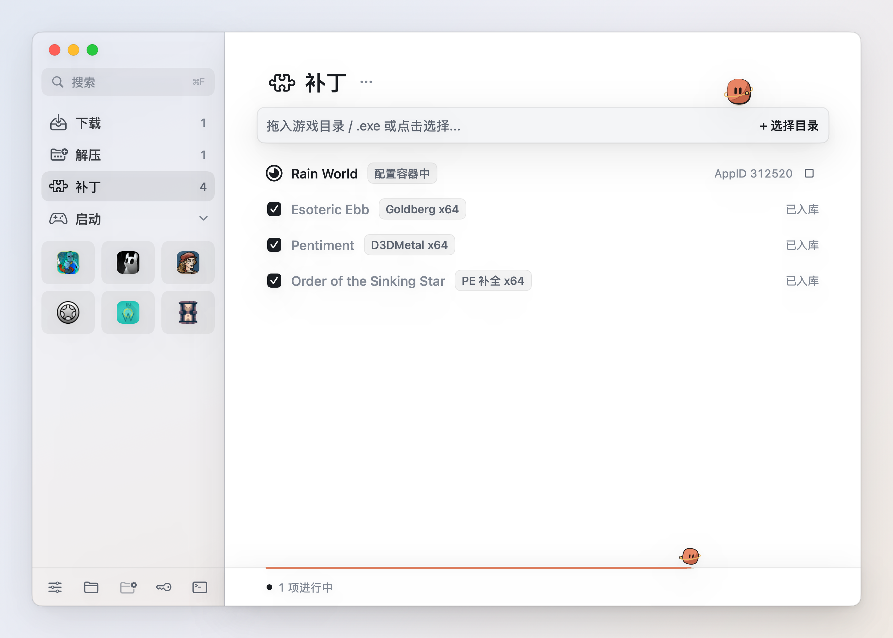
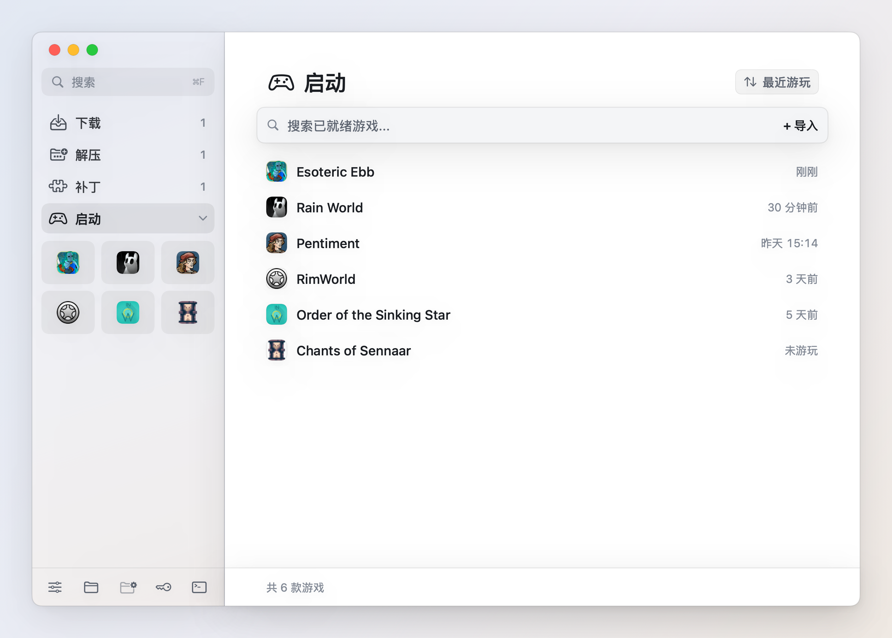
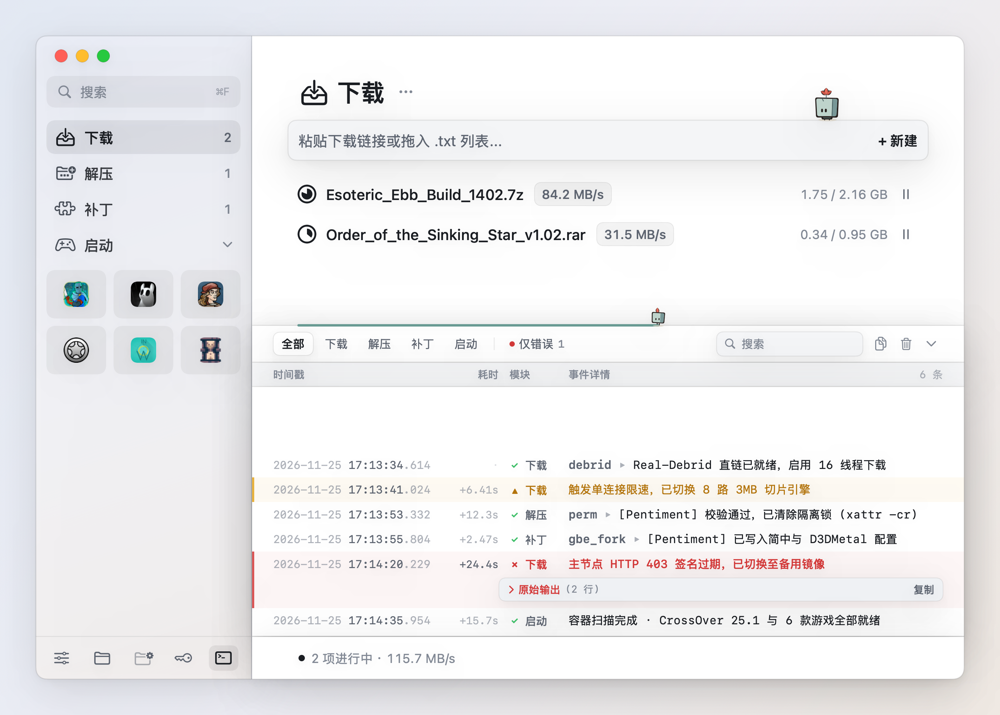
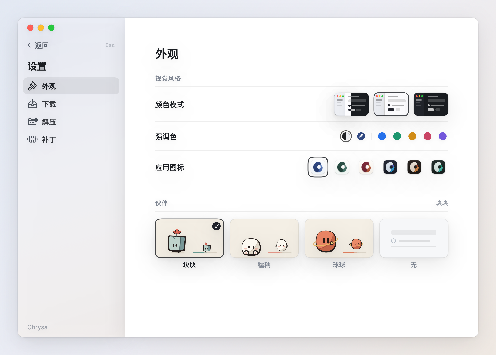

# Chrysa

面向 macOS（Apple Silicon）+ CrossOver 的原生 SwiftUI Windows 游戏流水线工具，将**下载 → 解压 → 补丁与容器配置 → 启动库管理**整合进同一个轻量窗口。

> 当前为 `v0.9.0` 公开测试版，仅提供 Apple Silicon（`arm64`）构建。

## 界面预览

| 下载队列 | 智能解压 |
| :---: | :---: |
|  |  |

| 补丁与容器配置 | 启动库 |
| :---: | :---: |
|  |  |

| 诊断日志抽屉 | 外观与伴生伙伴 |
| :---: | :---: |
|  |  |

## 核心功能

- **多源下载与断点续传**：内置独立打包的 `aria2c`（`sf-dl`），支持 Pixeldrain / Gofile / VikingFile / DataNodes / Qiwi / Workupload / KrakenFiles / Mail.ru / OneFichier / MirrorUploadX 等常见网盘解析（可选配置 Real-Debrid / TorBox 加速），具备智能代理分流、分卷聚合、断点续传、直链过期（HTTP 403/410）自动刷新与多镜像回退。
- **智能解压与无损覆盖更新**：内置零 Homebrew 依赖的 `7zz` 与 `unar`，支持密码词典自动试密、嵌套压缩包二次解包；更新同名游戏时先在同卷临时目录解压并自动迁移本地便携存档，确认完成后再原子替换旧目录。
- **补丁与 CrossOver 容器自动化**：PE 签名分流（保留已破解或免 DRM 构建）、Steam AppID 与 DLC 列表自动同步、自动创建/复用 CrossOver 容器、注入 macOS 中文字体映射与代理钩子 DLL 放行（`winhttp` / `version` / `dinput8` 等）。
- **启动库与 APFS 零空间快照**：统一管理已就绪游戏，支持切换主程序 `.exe`、自定义启动参数、图形后端（Auto / D3DMetal / DXMT / DXVK / WineD3D）与 Retina 模式；支持直接拖放汉化补丁 / DLC / UE `.pak` / `.exe` 安装器，安装前自动通过 APFS `clonefile` 创建零额外空间占用的基准快照，随时一键恢复纯净原版。
- **内置运行时，开箱即用**：Release 整包已内置独立重定位的 `sf-dl`、`7zz`、`unar` 与运行库，无需提前安装 Homebrew（仅直拆 GOG Inno Setup 安装包时按需依赖 `innoextract`）。

## 环境要求与安装

- **系统**：macOS 14.0（Sonoma）及以上
- **芯片**：Apple Silicon（M1 / M2 / M3 / M4 等 `arm64` 机型）
- **运行环境**：已安装 [CrossOver](https://www.codeweavers.com/crossover)

### 下载整包

1. 前往 [Releases](https://github.com/wooooci/Chrysa/releases) 下载最新的 `Chrysa-0.9.0-macos-arm64.zip`。
2. 解压后将 `Chrysa.app` 拖入 `/Applications`（或 `~/Applications`）。
3. 由于当前采用本地临时签名（ad-hoc），首次打开若系统提示「已损坏」或「无法验证开发者」，在终端执行以下命令清除隔离属性即可：

```bash
xattr -cr /Applications/Chrysa.app
```

### 从源码构建

```bash
# 运行全部单元测试
./scripts/swiftpm.sh test

# 构建并签名完整应用包（默认安装至 ~/Applications/Chrysa.app）
./build.sh
```

> 说明：`gbe_fork`（x64 / x86）DLL 已内置在源码仓库 `packaging/Resources/gbe_fork/` 中；应用图标资源会从已有 `~/Applications/Chrysa.app`（或 `CHRYSA_ASSET_APP`）复用，`build.sh` 同时会将本机 `aria2c`、`7zz`、`unar` 及其依赖库重定位打包进应用内。

## 友情链接

- [LINUX DO](https://linux.do) — 真诚、友善、团结、专业，共建你我引以为荣之社区
- [gbe_fork](https://github.com/Detanup01/gbe_fork) — Goldberg Steam Emulator 社区维护分支（Chrysa 内置 Steam 离线模拟核心）
